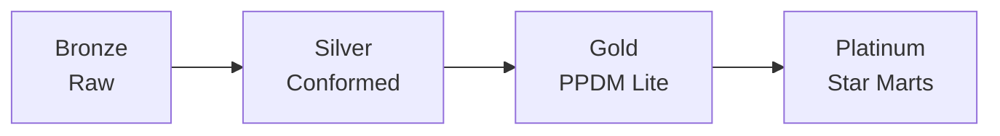
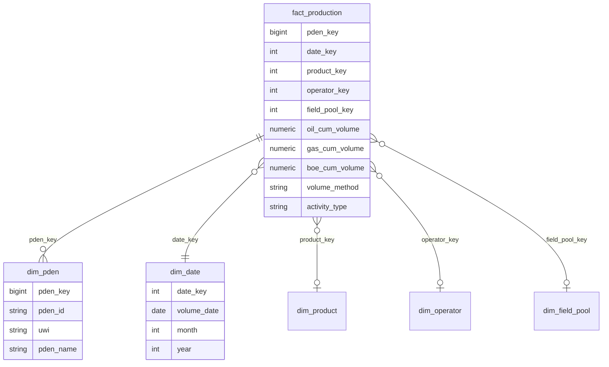
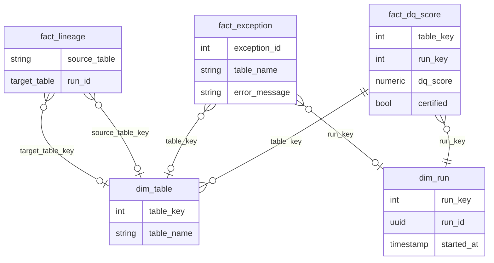

# Oil & Gas Executive BI Reporting Suite — Full Technical Product Specification

Modular BI data-product platform for private Oil & Gas companies using **PPDM Lite 1.1 (PostgreSQL)** as the consumption warehouse. Assumes full PPDM Lite 1.1 DDL is deployed; design builds Gold (PPDM Lite) → Platinum (star-schema marts) and governance on top.

---

## SECTION 0 — PRODUCT BLUEPRINT (Major product + 3 sub-products)

**Major product: Oil & Gas Executive BI Reporting Suite**  
A modular, PPDM Lite–based BI platform that gives private E&P companies a single source of truth for decision support, regulatory reporting, and investor communication. It combines a medallion data platform (Bronze → Silver → Gold/PPDM Lite), packaged star-schema data marts (Platinum), and reporting apps with drill-down and white-label options.

**Product A — Data Platform (Ingestion + Standardization + PPDM Lite consumption)**  
Objective: Ingest from masters, files, and partners into Bronze; standardize and validate in Silver; publish into PPDM Lite (Gold) with lineage, exceptions, and data-source governance. Target users: Data engineers, platform ops, data stewards. Value: One governed consumption layer (PPDM Lite) for all downstream marts and reports.

**Product B — Modular BI Data Marts (star schemas per module)**  
Objective: Define and maintain at least 10 Platinum marts (production, wells, reserves, land/contracts, finance, facilities, spatial, governance, partner/JV, regulatory) with explicit star schemas, KPIs, and 100-point coverage scoring (60% essential / 40% enhanced). Target users: Analysts, COO/CEO, Asset/Finance/Operations. Value: Consistent, auditable metrics and drill-down from company → asset → well → time.

**Product C — Reporting Apps (custom web app dashboards)**  
Objective: Web app (Company/Operator → Asset/Field/Pool → Well/PDEN → Day/Month). Target users: Executives, IR, operations. Value: Packaged, white-label reporting and export (Excel, PDF, investor decks).

**Combined roadmap**  
- **MVP:** Data Platform with Bronze/Silver/Gold (PPDM Lite), one Production Performance mart, lineage/exceptions, basic React dashboard.  
- **V1:** All 10 marts, conformed dimensions, 100-point coverage per mart, semantic models, RBAC + tenant isolation.  
- **V2:** White-label tiers, API per mart, predictive/risk add-ons, regulatory/compliance mart, full metadata catalog and certification workflows.

---

## SECTION 1 — REFERENCE MODEL SUMMARY (PPDM Lite fit-for-purpose)

- PPDM Lite 1.1 is a **warehouse-style summary model** for decision support and GIS browsing, not a transactional system; source-of-truth remains in master stores (e.g. PPDM 3.7 or operational DBs).
- It is **lightweight and replication-friendly**: optimized for bulk load and batch refresh, not OLTP.
- **Governance is built-in**: L_PPDM_TABLE, L_PPDM_COLUMN, L_PPDM_DATA_SOURCE, L_PPDM_EXCEPTION, L_PPDM_ORIGIN support catalog, lineage, and exception monitoring.
- **Subject coverage** aligns with E&P: wells, facilities, production entities/volumes, contracts, fields/pools, land rights, finance summaries, reserves, spatial.
- **Standard naming and structure** (e.g. L_PDEN, L_PDEN_VOL_SUMMARY, L_WELL, L_CONTRACT) enable cross-client and partner reuse.
- **GIS-ready** via spatial tables (L_SPATIAL_DESCRIPTION, L_SP_GEOMETRY, L_SP_POINT/LINE/POLYGON, L_SP_COMPONENT).
- **Not transactional**: no real-time writes from operations; all loads are batch/ELT into the consumption layer.

**Important PPDM Lite subject areas / tables (20+):**  
L_PDEN, L_PDEN_VOL_SUMMARY, L_PDEN_XREF, L_PDEN_STRAT_UNIT; L_WELL, L_WELL_ALIAS, L_WELL_SERVICE; L_FACILITY, L_FACILITY_ALIAS, L_FACILITY_SUBSTANCE, L_FACILITY_XREF; L_CONTRACT, L_CONTRACT_COMPONENT, L_CONT_ALIAS, L_CONT_EXTENSION; L_LAND_RIGHT, L_LAND_SALE, L_LAND_XREF; L_FIELD, L_POOL; L_FINANCE, L_FIN_COMPONENT, L_FIN_COST_SUMMARY, L_FIN_XREF; L_RESERVE_ENTITY, L_RESENT_CLASS, L_RESENT_COMPONENT, L_RESENT_XREF; L_PROJECT, L_PROJECT_COMPONENT; L_PPDM_TABLE, L_PPDM_COLUMN, L_PPDM_DATA_SOURCE, L_PPDM_EXCEPTION, L_PPDM_ORIGIN; L_SPATIAL_DESCRIPTION, L_SP_GEOMETRY, L_SP_COMPONENT, L_SP_POINT, L_SP_LINE, L_SP_POLYGON; L_ENTITLEMENT, L_ENT_COMPONENT, L_INTEREST_SET, L_INT_SET_PARTNER; L_RM_INFORMATION_ITEM, L_RM_INFO_ITEM_CONTENT, L_RM_INFO_ITEM_DESC; L_BUSINESS_ASSOCIATE, L_AREA, L_APPLICATION.

---

## SECTION 2 — SYSTEM ARCHITECTURE (Frontend + Backend + Data)

**Backend:** FastAPI (APIs, auth, orchestration triggers), dbt (Silver→Gold and Gold→Platinum transforms), Airflow or internal job runner (scheduling, dependency DAGs), PostgreSQL + PostGIS (Bronze/Silver/Gold/Platinum), Redis (cache/sessions).  
**Frontend:** (a) Custom React/Next.js Web apps w/light/dark, and color changeable schema  (connect to Platinum or Gold semantic models); (b) optional React/Next.js KPI portals with drill-down and export.  
**Security:** RBAC (admin, analyst, viewer); tenant isolation (schema or row-level by operator/portfolio); JWT for API; RLS on Platinum for multi-tenant and JV/partner access.

```mermaid
flowchart TB
  subgraph Frontend
    React/Next.js designed and custom Frontend Web apps
    React[React KPI Portals]
  end
  subgraph Backend
    API[FastAPI]
    dbt[dbt]
    Airflow[Airflow]
  end
  subgraph Data
    Bronze[Bronze]
    Silver[Silver]
    Gold[Gold - PPDM Lite]
    Platinum[Platinum Marts]
  end
  PowerBI --> API
  React --> API
  API --> Platinum
  API --> Gold
  Airflow --> dbt
  dbt --> Silver
  dbt --> Gold
  dbt --> Platinum
  Bronze --> Silver
  Silver --> Gold
  Gold --> Platinum
```



---

SECTION 3 — DATA PLATFORM (SIMPLIFIED 2-LAYER ARCHITECTURE)
Architectural Decision

The platform adopts a 2-layer warehouse architecture:

Silver Layer = PPDM Lite 1.1 (Integration + Conformed Layer)

Platinum Layer = Star-Schema Reporting Marts

No Bronze layer is implemented in this product scope.

Rationale

PPDM Lite is already:

Standardized

Normalized

Governance-aware

Designed for decision support

The product is not a generic ingestion SaaS.

Upstream systems (PPDM 3.7, operational DBs, SCADA, partner systems) remain systems of record.

This suite is a consumption + analytics product, not a master data management platform.

If raw retention is required, it is handled upstream — not in this product.

3.1 SILVER LAYER — PPDM Lite (Integration + Conformed Layer)

PPDM Lite acts as:

Data integration layer

Standardized E&P subject model

Governance-enabled warehouse

Publish-only data contract

3.1.1 Source Types (Upstream to PPDM Lite)

Although Bronze is not stored here, ingestion into PPDM Lite may originate from:

PPDM 3.7 master replication

Operational production systems

SCADA volume exports

Regulatory data feeds

Partner/JV spreadsheets

Financial systems

These are integrated via ELT pipelines directly into PPDM Lite.

3.1.2 Storage

Schema: ppdm_lite

All PPDM Lite tables are deployed per official DDL.

Additional supporting schemas:

meta (job runs, mapping_registry, certification logs)

ref (UOM, FX rates, domain harmonization)

security (tenant + RLS metadata)

3.1.3 Data Standardization Rules (Performed Before/At Load)

Even without Bronze, the following standardization rules are mandatory before publish:

1️⃣ Type Enforcement

Numeric columns strictly typed

Dates standardized to UTC

Enums validated against reference tables

2️⃣ Deduplication

Business keys enforced:

PDEN = (PDEN_ID, PDEN_TYPE, PDEN_SOURCE)

WELL = (WELL_ID, SOURCE)

CONTRACT = (CONTRACT_ID, SOURCE)

Duplicates rejected or versioned.

3️⃣ Unit Normalization

All volumes standardized to configured base UOM:

Oil → bbl

Gas → mcf or m3 (tenant-configurable)

BOE conversion factor configurable

Conversion performed using:

ref.uom_conversion

source UOM columns where present

4️⃣ Currency Normalization

Monetary values normalized to tenant reporting currency.

FX conversion table:

ref.fx_rates

keyed by currency_code + date

Both original_currency and reporting_currency retained where applicable.

5️⃣ Time Standardization

All datetime values stored in UTC.

Tenant-local time rendered only at UI layer.

3.1.4 Validation & Exception Handling

All rule violations must be captured.

Exception Table Structure

Schema: meta.data_exception

Columns:

exception_id

run_id

table_name

column_name

rule_name

message

severity (info/warn/error)

tenant_id

created_at

These align conceptually with PPDM governance tables.

Handling

Hard failures: block publish.

Soft failures: publish allowed but mark dataset uncertified.

Exception trend aggregated into Governance Mart.

3.1.5 ELT Publish to PPDM Lite

ELT driven by:

meta.mapping_registry

Structure:

source_table

source_column

target_table

target_column

transformation_expression

is_required (boolean)

Modes

Full refresh

Incremental (based on last_updated timestamp or source watermark)

3.1.6 DATA_SOURCE Governance

Mandatory:

Populate L_PPDM_DATA_SOURCE

Every published row must carry:

DATA_SOURCE

load_run_id

tenant_id

This enables:

lineage tracking

certification scoring

multi-source environments

3.1.7 Refresh Strategy
Subject Area	Frequency
Production volumes	Daily or hourly
Wells & Facilities	Daily
Financial	Monthly
Reserves	Monthly
Contracts/Land	Weekly/Monthly
Spatial	Weekly
3.1.8 Access Rules

PPDM Lite is publish-only

No direct UI edits permitted

Only transformation jobs may write to it

Read-only access granted to:

API layer

dbt Platinum transformations

Admin data stewardship screens (read-only)

3.2 PLATINUM LAYER — REPORTING MARTS

Platinum = Dimensional Reporting Layer

Each mart:

Derived only from PPDM Lite

Star schema

Conformed dimensions

Coverage scoring (100-point 60/40 model)

Certified flag

3.2.1 Platinum Schema Structure

Schemas:

marts_production

marts_asset

marts_reserves

marts_contract

marts_finance

marts_facility

marts_spatial

marts_governance

marts_jv

marts_regulatory

Shared dimension schema:

marts_shared

3.2.2 Mart Build Rules

Built via dbt models

Must include:

surrogate keys

SCD strategy (Type 1 or 2 as defined)

not-null + relationship tests

refresh timestamp

load_run_id

tenant_id

3.2.3 Coverage Scoring (Mandatory)

Each mart must compute:

essential_coverage_pct

enhanced_coverage_pct

dq_score (0–100)

certified_ind (dq_score ≥ 80 AND essential ≥ 90%)

Stored in:
marts_governance.fact_dq_score

3.2.4 Access Rules

RLS enforced at Platinum layer.

Tenant isolation applied here.

JV entitlement filters applied here.

Finance masking applied here.

Revised Architecture Diagram (2-Layer Model)
flowchart LR
  SRC[Upstream Systems] --> SILVER[PPDM Lite\nConformed Integration Layer]
  SILVER --> PLATINUM[Star Schema Reporting Marts]
  PLATINUM --> APP[Web Reporting Suite]

Architectural Implications of Removing Bronze
Benefits

✔ Simpler architecture
✔ Faster implementation
✔ Lower storage footprint
✔ Clear separation of operational vs reporting systems
✔ Easier certification logic

Trade-offs

✖ No raw replay capability
✖ No historical source fidelity snapshots
✖ Upstream systems remain ultimate raw record

For private E&P reporting suite — this is acceptable.

Final Architecture Summary
Layer	Purpose	Write Access	Read Access
PPDM Lite (Silver)	Integration + governance	ELT jobs only	API + dbt
Platinum	Dimensional reporting	dbt only	API + UI
UI/API	Presentation	N/A	Users


---

## SECTION 4 — MODULAR BI DATA MART CATALOG (PLATINUM LAYER)

Each mart: business objective, primary users, PPDM Lite source tables, grain, star schema (fact + dims), KPI library (12+), 100-point coverage (60 essential / 40 enhanced), suggested report layouts, refresh frequency, advanced analytics add-ons.

---

### 4.1 Production Performance Mart

- **Objective:** Daily/monthly production by PDEN, product, and geography; trend and variance.  
- **Users:** COO, Asset, Operations.  
- **PPDM Lite tables:** L_PDEN, L_PDEN_VOL_SUMMARY, L_PDEN_XREF, L_FIELD, L_POOL, L_WELL, L_PPDM_DATA_SOURCE.  
- **Grain:** One row per PDEN per volume date per volume method per activity type (fact); dimensions: dim_pden, dim_date, dim_product, dim_operator, dim_field_pool.  
- **Star schema (text):**  
  - **Fact:** fact_production (pden_id, pden_type, pden_source, volume_date, volume_method, activity_type, primary_product, oil_cum_volume, gas_cum_volume, water_cum_volume, boe_cum_volume, oil_volume_ouom, gas_volume_ouom, data_source, field_id, pool_id, operator_id, … 20+ columns).  
  - **Dims:** dim_pden (pden_key, pden_id, pden_type, pden_source, pden_name, uwi, primary_product, …), dim_date, dim_product, dim_operator, dim_field_pool.  
- **Coverage (100 pts):** Essential 60: L_PDEN (PDEN_ID, PDEN_TYPE, PDEN_SOURCE, PDEN_NAME, DATA_SOURCE, UWI, PRIMARY_PRODUCT, POOL_ID), L_PDEN_VOL_SUMMARY (PDEN_ID, PDEN_TYPE, PDEN_SOURCE, VOLUME_DATE, VOLUME_METHOD, ACTIVITY_TYPE, OIL_CUM_VOLUME, GAS_CUM_VOLUME, PRIMARY_PRODUCT, DATA_SOURCE). Enhanced 40: L_PDEN (REMARK, OTHER_NAME), L_PDEN_VOL_SUMMARY (WATER_CUM_VOLUME, BOE_CUM_VOLUME, REMARK, UOM columns), L_PDEN_XREF.  
- **KPIs (12+):**  
  1. Total Oil Production (MTD) = SUM(fact_production.oil_cum_volume) WHERE date_key in month.  
  2. Total Gas Production (MTD) = SUM(gas_cum_volume) same.  
  3. BOE Production (MTD) = SUM(boe_cum_volume) or oil + gas/6.  
  4. YoY Growth % = (This Year - Last Year) / Last Year * 100.  
  5. Production per Well = Total volume / COUNT(DISTINCT pden_key).  
  6. Top 10 PDENs by Oil = RANK by oil_cum_volume.  
  7. Decline Rate = (Prior period - Current) / Prior period.  
  8. Utilization % = Producing wells / Total wells * 100.  
  9. Forecast vs Actual = SUM(actual) vs SUM(forecast) by period.  
  10. By Field = SUM(volumes) GROUP BY field_key.  
  11. By Pool = SUM(volumes) GROUP BY pool_key.  
  12. By Operator = SUM(volumes) GROUP BY operator_key.  
- **Reports:** Executive production summary; trend by product; map by field; drill Company → Field → Well → Day.  
- **Refresh:** Daily.  
- **Advanced:** Production forecasting (time series), decline curve, anomaly detection.



---

### 4.2 Asset & Well Performance Mart

- **Objective:** Well master, aliases, service history, strat links; well-level KPIs.  
- **Users:** Asset, Geoscience, Operations.  
- **PPDM Lite tables:** L_WELL, L_WELL_ALIAS, L_WELL_SERVICE, L_PDEN, L_STRAT_WELL_SECTION, L_STRAT_UNIT, L_FACILITY, L_PPDM_DATA_SOURCE.  
- **Grain:** One row per well per service event (fact_well_service); one row per well (dim_well).  
- **Fact:** fact_well_service (well_key, pden_key, service_date, service_type, … 20+ cols). **Dims:** dim_well (well_key, well_id, uwi, well_name, status, …), dim_pden, dim_date, dim_facility.  
- **Coverage:** Essential 60: L_WELL (WELL_ID, SOURCE, UWI, DATA_SOURCE, STATUS, FACILITY_ID/TYPE), L_WELL_SERVICE (WELL_ID, SOURCE, SERVICE_DATE, SERVICE_TYPE). Enhanced 40: L_WELL_ALIAS, L_WELL (REMARK, dates), L_STRAT_WELL_SECTION.  
- **KPIs:** Well count; wells on production; service events count; average well life; top wells by production; well status distribution.  
- **Refresh:** Daily. **Advanced:** Well failure risk, workover optimization.

---

### 4.3 Reserves & Resource Classification Mart

- **Objective:** Reserves entities, classes, components; project linkage.  
- **Users:** CEO, Finance, Reserves/Subsurface.  
- **PPDM Lite tables:** L_RESERVE_ENTITY, L_RESENT_CLASS, L_RESENT_COMPONENT, L_RESENT_XREF, L_PROJECT, L_PDEN, L_PPDM_DATA_SOURCE.  
- **Grain:** One row per reserve entity per class per component (fact_reserves). **Dims:** dim_reserve_entity, dim_project, dim_pden, dim_date.  
- **Coverage:** Essential 60: L_RESERVE_ENTITY (key cols, DATA_SOURCE), L_RESENT_CLASS, L_RESENT_COMPONENT (entity, class, volume columns). Enhanced 40: L_RESENT_XREF, L_PROJECT, REMARK columns.  
- **KPIs:** 1P/2P/3P volumes; reserves replacement ratio; reserves by project/entity; YoY change.  
- **Refresh:** Monthly. **Advanced:** Reserves forecasting, uncertainty ranges.

---

### 4.4 Land & Contract Exposure Mart

- **Objective:** Contract and land-right exposure; linkage to facility, field, PDEN, UWI.  
- **Users:** Land, Legal, Finance.  
- **PPDM Lite tables:** L_CONTRACT, L_CONTRACT_COMPONENT, L_CONT_EXTENSION, L_LAND_RIGHT, L_LAND_SALE, L_LAND_XREF, L_FACILITY, L_FIELD, L_PDEN, L_PPDM_DATA_SOURCE.  
- **Grain:** One row per contract component per effective period (fact_contract_exposure). **Dims:** dim_contract, dim_land_right, dim_facility, dim_field.  
- **Coverage:** Essential 60: L_CONTRACT (CONTRACT_ID, SOURCE, DATA_SOURCE), L_CONTRACT_COMPONENT (contract, facility/field/pden links), L_LAND_RIGHT (key cols). Enhanced 40: L_CONT_EXTENSION, L_LAND_SALE, aliases.  
- **KPIs:** Contract count; expiring contracts (90/180/365 days); exposure by area/facility; acreage.  
- **Refresh:** Weekly/monthly. **Advanced:** Renewal risk, exposure concentration.

---

### 4.5 Financial & Cost Intelligence Mart

- **Objective:** Finance and cost summaries; link to project/facility/pden.  
- **Users:** CFO, Finance, Asset.  
- **PPDM Lite tables:** L_FINANCE, L_FIN_COMPONENT, L_FIN_COST_SUMMARY, L_FIN_XREF, L_PROJECT, L_FACILITY, L_PDEN, L_PPDM_DATA_SOURCE.  
- **Grain:** One row per finance record per cost summary period (fact_finance). **Dims:** dim_project, dim_facility, dim_pden, dim_date, dim_currency.  
- **Coverage:** Essential 60: L_FINANCE (key, DATA_SOURCE), L_FIN_COST_SUMMARY (amounts, dates, links). Enhanced 40: L_FIN_COMPONENT, L_FIN_XREF, currency/UOM.  
- **KPIs:** Capex/Opex by project; cost per BOE; budget vs actual; by facility/well.  
- **Refresh:** Monthly. **Advanced:** Cost forecasting, variance drivers.

---

### 4.6 Facility & Infrastructure Utilization Mart

- **Objective:** Facility master, substances, utilization.  
- **Users:** Operations, Asset.  
- **PPDM Lite tables:** L_FACILITY, L_FACILITY_ALIAS, L_FACILITY_SUBSTANCE, L_FACILITY_XREF, L_FIELD, L_PDEN, L_PPDM_DATA_SOURCE.  
- **Grain:** One row per facility per period (fact_facility_utilization). **Dims:** dim_facility, dim_field, dim_date.  
- **Coverage:** Essential 60: L_FACILITY (FACILITY_ID, TYPE, NAME, DATA_SOURCE, status/operator). Enhanced 40: L_FACILITY_SUBSTANCE, L_FACILITY_XREF, dates.  
- **KPIs:** Facility count; utilization %; capacity vs throughput; by type/field.  
- **Refresh:** Daily/weekly. **Advanced:** Capacity optimization, bottleneck analysis.

---

### 4.7 Spatial Intelligence Mart (GIS-ready)

- **Objective:** Maps, layers, geometry; link to PDEN, facility, land.  
- **Users:** Geoscience, Land, Operations.  
- **PPDM Lite tables:** L_SPATIAL_DESCRIPTION, L_SP_GEOMETRY, L_SP_POINT, L_SP_LINE, L_SP_POLYGON, L_SP_COMPONENT, L_SP_BOUNDARY, L_PDEN, L_FACILITY, L_LAND_RIGHT, L_PPDM_DATA_SOURCE.  
- **Grain:** One row per spatial feature (fact_spatial_feature); geometry in dim or fact. **Dims:** dim_spatial_type, dim_pden, dim_facility.  
- **Coverage:** Essential 60: L_SPATIAL_DESCRIPTION, L_SP_GEOMETRY (or L_SP_POINT/LINE/POLYGON), L_SP_COMPONENT (links to pden/facility/land). Enhanced 40: L_SP_BOUNDARY, attributes.  
- **KPIs:** Feature counts by type; area; intersection stats; coverage by asset.  
- **Refresh:** Daily/weekly. **Advanced:** Proximity analysis, heat maps.

---

### 4.8 Governance & Data Quality Mart

- **Objective:** Catalog, lineage, exceptions; certification status.  
- **Users:** Data stewards, Platform ops, Compliance.  
- **PPDM Lite tables:** L_PPDM_TABLE, L_PPDM_COLUMN, L_PPDM_EXCEPTION, L_PPDM_ORIGIN, L_PPDM_DATA_SOURCE.  
- **Grain:** One row per table per run (fact_dq_score); one row per exception (fact_exception); lineage edges (fact_lineage). **Dims:** dim_table, dim_run, dim_source.  
- **Coverage:** Essential 60: L_PPDM_TABLE (TABLE_NAME), L_PPDM_COLUMN (TABLE_NAME, COLUMN_NAME), L_PPDM_ORIGIN (source/target table/column, run_id), L_PPDM_EXCEPTION (table, column, message, run_id). Enhanced 40: comments, DATA_SOURCE.  
- **KPIs:** Tables/columns covered; exception count by table/run; lineage depth; certification % (e.g. 100-pt score ≥80).  
- **Refresh:** Per run + daily snapshot. **Advanced:** Exception trend, root-cause clustering.



---

### 4.9 Partner/JV & Entitlements Mart

- **Objective:** Entitlements, interest sets, partner shares.  
- **Users:** Finance, Legal, JV.  
- **PPDM Lite tables:** L_ENTITLEMENT, L_ENT_COMPONENT, L_ENT_GROUP, L_INTEREST_SET, L_INT_SET_COMPONENT, L_INT_SET_PARTNER, L_CONTRACT, L_FACILITY, L_PDEN, L_PPDM_DATA_SOURCE.  
- **Grain:** One row per entitlement component per period (fact_entitlement). **Dims:** dim_partner, dim_interest_set, dim_contract.  
- **Coverage:** Essential 60: L_ENTITLEMENT, L_ENT_COMPONENT (entity, share, dates), L_INTEREST_SET, L_INT_SET_PARTNER. Enhanced 40: L_ENT_GROUP, L_INT_SET_COMPONENT.  
- **KPIs:** Partner count; entitlement % by asset; JV revenue share; variance.  
- **Refresh:** Monthly. **Advanced:** JV reconciliation, partner risk.

---

### 4.10 Regulatory & Compliance / Information Item Mart

- **Objective:** Regulatory information items, content, descriptions; link to contracts/obligations.  
- **Users:** Compliance, Legal, IR.  
- **PPDM Lite tables:** L_RM_INFORMATION_ITEM, L_RM_INFO_ITEM_CONTENT, L_RM_INFO_ITEM_DESC, L_CONTRACT, L_LAND_RIGHT, L_PPDM_DATA_SOURCE.  
- **Grain:** One row per information item per version (fact_regulatory_item). **Dims:** dim_regulatory_type, dim_contract, dim_date.  
- **Coverage:** Essential 60: L_RM_INFORMATION_ITEM (key, type, DATA_SOURCE), L_RM_INFO_ITEM_CONTENT. Enhanced 40: L_RM_INFO_ITEM_DESC, links to contract/land.  
- **KPIs:** Items due by period; compliance rate; by jurisdiction/type.  
- **Refresh:** Weekly/monthly. **Advanced:** Due-date prediction, compliance risk.

---

## SECTION 5 — CONFORMED DIMENSIONS (SHARED ACROSS MARTS)

| Dimension       | Keys              | SCD   | PPDM Lite mapping                                                                 |
|----------------|-------------------|-------|-------------------------------------------------------------------------------------|
| dim_date       | date_key (int)    | N/A   | Derived from VOLUME_DATE, SERVICE_DATE, etc.                                        |
| dim_operator   | operator_key      | Type 2| L_BUSINESS_ASSOCIATE, CURRENT_OPERATOR in L_PDEN/L_FACILITY                         |
| dim_asset      | asset_key         | Type 2| L_FIELD, L_POOL, L_PDEN, L_WELL (field_id, pool_id, pden_id, well_id)               |
| dim_location   | location_key      | Type 2| L_AREA, L_SPATIAL_DESCRIPTION, PROVINCE_STATE, COUNTRY                              |
| dim_product    | product_key       | Type 1| PRIMARY_PRODUCT, activity/product reference                                          |
| dim_contract   | contract_key      | Type 2| L_CONTRACT, L_CONTRACT_COMPONENT                                                     |
| dim_facility   | facility_key      | Type 2| L_FACILITY                                                                          |
| dim_project    | project_key       | Type 2| L_PROJECT, L_PROJECT_COMPONENT                                                      |

---

## SECTION 6 — METADATA MANAGEMENT + CATALOG

- **Data Dictionary Generator:** Query L_PPDM_TABLE and L_PPDM_COLUMN (plus information_schema) to emit table/column lists, types, and comments; expose via API and optionally export YAML/JSON per mart.  
- **Lineage Tracker:** Query L_PPDM_ORIGIN (source_table/column → target_table/column, run_id) to build graph; filter by run, target table, or column for impact analysis.  
- **Data Exception Monitor:** Aggregate L_PPDM_EXCEPTION by table, column, run, date; trend and root-cause (e.g. by source or rule).  
- **Example metadata record (YAML) per mart:**

```yaml
mart: production_performance
tables:
  - name: fact_production
    definition: "One row per PDEN per volume date per method per activity type"
    owner: data-platform
    refresh_sla: "T+1 daily"
    sensitivity: internal
    source_tables: [L_PDEN, L_PDEN_VOL_SUMMARY]
  - name: dim_pden
    definition: "Conformed PDEN dimension"
    owner: data-platform
columns:
  - table: fact_production
    column: oil_cum_volume
    definition: "Cumulative oil volume"
    rule: "From L_PDEN_VOL_SUMMARY.OIL_CUM_VOLUME; normalized to bbl"
```

---

## SECTION 7 — DATA GOVERNANCE & ETHICS

- **Policies:** Data minimization (only required for marts); purpose limitation (documented per mart); access control (RBAC + RLS); audit logs (who accessed what); retention (by layer and mart); privacy-by-design (PII in Silver/Gold only where needed).  
- **Controls:** Certification status (e.g. 100-pt score ≥80); approval workflow for KPI definitions; versioning for mart schemas and logic.  
- **RLS:** Multi-tenant: filter Platinum (and optionally Gold) by operator_id or portfolio_id; JV/partner: filter by interest_set or entitlement so partners see only their share.

---

## SECTION 8 — API LAYER + WHITE LABEL COMMERCIAL MODEL

- **Licensing tiers:** Core (Production + 2 marts), Advanced (+ all 10 marts, API), Enterprise (+ white-label, SLA, dedicated support).  
- **Modular subscription:** Per-mart activation.  
- **White-label:** Per-client branding (logo, theme); isolated tenant (schema or RLS); per-client semantic model.  
- **API:** REST per mart, e.g. `/v1/marts/production/kpis`, `/v1/marts/contracts/exposure`, `/v1/marts/governance/lineage`.  
- **Export:** Excel, PDF packs, investor-ready monthly deck (automated from Platinum).

---

*This document is the full technical product specification for the Oil & Gas Executive BI Reporting Suite. All marts consume only PPDM Lite (Gold); Platinum star schemas and 100-point coverage (60/40 tranches) are defined per mart above.*
