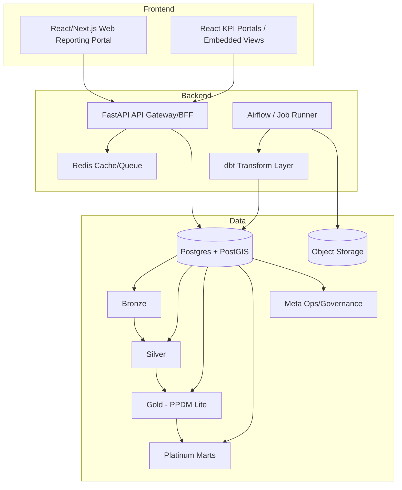
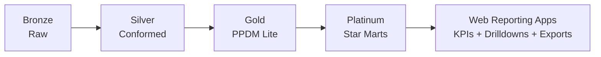
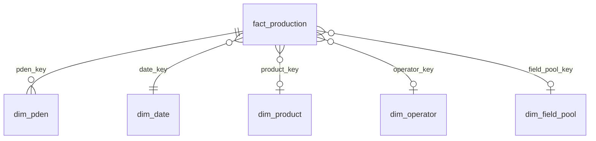

# Technical Requirements Document

## Oil & Gas Executive BI Reporting Suite — Full Technical Product Specification (All-Inclusive)

**Purpose:** Modular BI data-product platform for private Oil & Gas companies using **PPDM Lite 1.1 (PostgreSQL)** as the **Gold consumption warehouse**. Assumes full PPDM Lite 1.1 DDL is deployed. Design builds **Gold (PPDM Lite) → Platinum (star-schema marts)** plus governance, API, and reporting apps on top.

**Version:** 1.0  
**Status:** Draft — Build Ready  
**Primary Users:** Private E&P leadership and functional teams (Exec, Asset, Ops, Finance, Land/Legal, Geoscience, IR), plus Data Stewardship/Platform Ops.

**Companion documents:**
- **Requirements Matrix** — `REQUIREMENTS_MATRIX.md` (REQ-ID, priority, owner, acceptance test).
- **Mart Star Schema Pack** — `MART_STAR_SCHEMA_PACK.md` (≥20 fact / ≥10 dim columns, ≥12 KPIs, 60–40 coverage map per mart).

---

## SECTION 0 — PRODUCT BLUEPRINT (Major product + 3 sub-products)

### Major Product: **Oil & Gas Executive BI Reporting Suite**

A modular, PPDM Lite–based BI platform that gives private E&P companies a single source of truth for decision support, regulatory reporting, and investor communication. It combines:

* **Medallion Data Platform** (Bronze → Silver → Gold/PPDM Lite),
* **Packaged star-schema data marts** (Platinum),
* **First-party reporting apps** with drill-down, export packs, and white-label options.

### Product A — **Data Platform** (Ingestion + Standardization + PPDM Lite consumption)

**Objective:** Ingest from masters/files/partners into Bronze; standardize and validate in Silver; publish into PPDM Lite (Gold) with lineage, exceptions, and data-source governance.  
**Target users:** Data engineers, platform ops, data stewards.  
**Value:** One governed consumption layer (PPDM Lite) for all downstream marts and reports.

### Product B — **Modular BI Data Marts** (star schemas per module)

**Objective:** Define and maintain at least **10 Platinum marts** (production, wells, reserves, land/contracts, finance, facilities, spatial, governance, partner/JV, regulatory) with explicit star schemas, KPIs, and **100-point coverage scoring** (**60% essential / 40% enhanced**).  
**Target users:** Analysts, CEO/COO, Asset/Finance/Operations/IR.  
**Value:** Consistent, auditable metrics and drill-down from company → asset → well → time.

### Product C — **Reporting Apps** (custom web app dashboards)

**Objective:** First-party reporting web app that supports Operator → Asset/Field/Pool → Well/PDEN → Day/Month drill-down, saved views, KPI explanation, and exports.  
**Target users:** Executives, IR, operations.  
**Value:** Packaged, white-label reporting and export (Excel/CSV, PDF packs, investor decks).

### Combined Roadmap

* **MVP:** Data Platform with Bronze/Silver/Gold (PPDM Lite), **one Production Performance mart**, lineage/exceptions, basic React dashboard.
* **V1:** All **10 marts**, conformed dimensions, 100-point coverage per mart, **RBAC + tenant isolation**.
* **V2:** White-label tiers, API per mart, predictive/risk add-ons, regulatory/compliance mart enhancements, full metadata catalog and certification workflows.

---

## SECTION 1 — REFERENCE MODEL SUMMARY (PPDM Lite fit-for-purpose)

### Why PPDM Lite works here (fit-for-purpose bullets)

* PPDM Lite 1.1 is a **warehouse-style summary model** for decision support and GIS browsing, not transactional; source-of-truth remains in master stores.
* It is **lightweight and replication-friendly**: optimized for bulk load and batch refresh, not OLTP.
* **Governance is built-in** via L_PPDM_* tables: table/column catalog, data source tracking, exceptions, and origin/lineage.
* **Subject coverage** aligns with E&P: wells, facilities, production entities/volumes, contracts, fields/pools, land rights, finance summaries, reserves, spatial.
* **Standard naming and structure** (e.g., L_PDEN, L_PDEN_VOL_SUMMARY, L_WELL, L_CONTRACT) enables cross-client reuse.
* **GIS-ready** via spatial tables (L_SPATIAL_DESCRIPTION, L_SP_GEOMETRY, L_SP_POINT/LINE/POLYGON, L_SP_COMPONENT).
* **Not transactional:** no real-time operational writes; all loads are batch/ELT.

### Important PPDM Lite subject areas / tables (20+)

L_PDEN, L_PDEN_VOL_SUMMARY, L_PDEN_XREF, L_PDEN_STRAT_UNIT;  
L_WELL, L_WELL_ALIAS, L_WELL_SERVICE;  
L_FACILITY, L_FACILITY_ALIAS, L_FACILITY_SUBSTANCE, L_FACILITY_XREF;  
L_CONTRACT, L_CONTRACT_COMPONENT, L_CONT_ALIAS, L_CONT_EXTENSION;  
L_LAND_RIGHT, L_LAND_SALE, L_LAND_XREF;  
L_FIELD, L_POOL;  
L_FINANCE, L_FIN_COMPONENT, L_FIN_COST_SUMMARY, L_FIN_XREF;  
L_RESERVE_ENTITY, L_RESENT_CLASS, L_RESENT_COMPONENT, L_RESENT_XREF;  
L_PROJECT, L_PROJECT_COMPONENT;  
L_PPDM_TABLE, L_PPDM_COLUMN, L_PPDM_DATA_SOURCE, L_PPDM_EXCEPTION, L_PPDM_ORIGIN;  
L_SPATIAL_DESCRIPTION, L_SP_GEOMETRY, L_SP_COMPONENT, L_SP_POINT, L_SP_LINE, L_SP_POLYGON;  
L_ENTITLEMENT, L_ENT_COMPONENT, L_INTEREST_SET, L_INT_SET_PARTNER;  
L_RM_INFORMATION_ITEM, L_RM_INFO_ITEM_CONTENT, L_RM_INFO_ITEM_DESC;  
L_BUSINESS_ASSOCIATE, L_AREA, L_APPLICATION.

---

## SECTION 2 — SYSTEM ARCHITECTURE (Frontend + Backend + Data)

### 2.1 Backend stack (practical)

* **FastAPI**: API gateway/BFF, auth/RBAC enforcement, tenant routing, serving module endpoints, export triggers, metadata endpoints.
* **dbt**: Transform layer for:
  * Silver standardization models
  * Gold PPDM Lite publish logic (where applicable)
  * Gold → Platinum star-schema marts
  * Test suite (not_null, relationships, accepted_values)
  * Documentation generation for metadata showcase
* **Airflow** (or internal runner in MVP): schedules ingestion, transformation, publish, mart builds, governance scoring.
* **PostgreSQL + PostGIS**: core warehouse + spatial enablement.
* **Redis**: caching expensive KPIs, report builder saved queries, background job queues.
* **Object storage (S3/MinIO)**: bronze file landing and PDF/Excel report packs.

### 2.2 Frontend (first-party, not BI-tool dependent)

Primary UI is a **React/Next.js reporting portal**:

* KPI tiles, trends, pivots, maps, drill-down paths
* Report Builder (save views, schedule exports)
* KPI Explain panel (definition + lineage + DQ score + last refresh)
* Admin screens for data stewardship (exceptions, certification status, metadata dictionary)

> External BI tools (e.g. Power BI, Tableau) are **optional consumers** later, but not required for the system.

### 2.3 Security

* **RBAC**: admin, analyst, viewer, finance_analyst, geo_analyst, data_steward, api_client.
* **Tenant isolation**:
  * Shared DB + **RLS** (recommended SaaS)
  * Schema-per-tenant (enterprise)
  * DB-per-tenant (high-security)
* **JWT** for API authentication.
* **Row Level Security** on Platinum marts and optionally Gold.

### 2.4 Architecture diagram (first-party web primary; no Power BI central)



### 2.5 Medallion lineage diagram



---

## SECTION 3 — DATA PLATFORM (BRONZE + SILVER + GOLD)

### BRONZE

* **Source types:** PPDM master replication (bulk extract), CSVs, SCADA/volumes extracts, regulatory feeds, partner/JV spreadsheets.
* **Storage:** raw schema `bronze`, file registry (path, checksum, load time), ingestion logs (run_id, source_id, row counts, status).
* **Rules:** append-only; no overwrite.

### SILVER

* **Canonical staging:** typed columns, dedupe by business key, harmonize reference values (product codes, UOM, currency).
* **Unit/currency normalization rules:**
  * Standard volumes (oil/gas/water/BOE) using UOM dimension and conversion table
  * FX rate table to reporting currency (USD/CAD/NGN etc as configured)
  * Standard time zone (UTC or tenant default)
* **Validation and exceptions:** log rule failures to standardized exception table aligned with PPDM exception concepts:
  * table, column, rule, message, severity, run_id
  * quarantine or flag rows.

### GOLD (PPDM Lite)

* **Load/maintain:** ELT from Silver using `mapping_registry` (source_table/column → target_table/column).
* **data_source governance:** populate L_PPDM_DATA_SOURCE and set row-level DATA_SOURCE consistently.
* **Refresh:** daily batch typical; hourly for volumes if needed; monthly for reserves/contracts.
* **No UI edits**: PPDM Lite is publish-only.

---

## SECTION 4 — MODULAR BI DATA MART CATALOG (PLATINUM LAYER)

**Global rule:** Every mart must include:

* Business objective
* Primary users
* PPDM Lite source tables
* Grain
* Star schema (fact + dims)
* KPI library (12+)
* 100-point coverage scoring with 60 essential / 40 enhanced
* Suggested report layouts
* Refresh frequency
* Advanced analytics add-ons

> Detailed star schemas (≥20 fact columns / ≥10 dim columns), full KPI definitions, and 60–40 coverage maps are in the **Mart Star Schema Pack** (separate document).

---

### 4.1 Production Performance Mart

**Objective:** Daily/monthly production by PDEN/product/geography; trend and variance.  
**Users:** COO, Asset, Operations.  
**PPDM Lite tables:** L_PDEN, L_PDEN_VOL_SUMMARY, L_PDEN_XREF, L_FIELD, L_POOL, L_WELL, L_PPDM_DATA_SOURCE.  
**Grain:** One row per PDEN per volume_date per volume_method per activity_type.

**Star Schema**

* **Fact:** `marts_production.fact_production` (≥20 cols)
  * Keys: tenant_id, pden_key, date_key, product_key, operator_key, field_pool_key
  * Measures: oil_cum_volume, gas_cum_volume, water_cum_volume, boe_cum_volume
  * Attributes: volume_method, activity_type, uom keys, data_source, load_run_id, refreshed_at
* **Dims:** `dim_pden`, `dim_date`, `dim_product`, `dim_operator`, `dim_field_pool`

**Coverage (100 pts)**

* **Essential 60 (must-have):**
  * L_PDEN: PDEN_ID, PDEN_TYPE, PDEN_SOURCE, PDEN_NAME, DATA_SOURCE, UWI, PRIMARY_PRODUCT, POOL_ID
  * L_PDEN_VOL_SUMMARY: PDEN_ID, PDEN_TYPE, PDEN_SOURCE, VOLUME_DATE, VOLUME_METHOD, ACTIVITY_TYPE, OIL_CUM_VOLUME, GAS_CUM_VOLUME, PRIMARY_PRODUCT, DATA_SOURCE
* **Enhanced 40:**
  * L_PDEN: REMARK, OTHER_NAME
  * L_PDEN_VOL_SUMMARY: WATER_CUM_VOLUME, BOE_CUM_VOLUME, REMARK, UOM columns
  * L_PDEN_XREF

**KPIs (12+)** — See Mart Star Schema Pack §1.

**Reports:** Exec summary, trends, rankings, drill-down pages (operator → field → pden → daily).  
**Refresh:** Daily (or hourly if upstream supports).  
**Advanced:** Forecasting, decline curves, anomaly detection.



---

### 4.2 Asset & Well Performance Mart

**Objective:** Well master, aliases, service history, strat links; well-level KPIs.  
**Users:** Asset, Geoscience, Operations.  
**PPDM Lite tables:** L_WELL, L_WELL_ALIAS, L_WELL_SERVICE, L_PDEN, L_STRAT_WELL_SECTION, L_STRAT_UNIT, L_FACILITY, L_PPDM_DATA_SOURCE.  
**Grain:** One row per well per service event (fact_well_service); one row per well (dim_well).

**Coverage:** Essential 60: L_WELL (WELL_ID, SOURCE, UWI, DATA_SOURCE, STATUS, FACILITY_ID/TYPE), L_WELL_SERVICE (WELL_ID, SOURCE, SERVICE_DATE, SERVICE_TYPE). Enhanced 40: L_WELL_ALIAS, L_WELL remarks/dates, L_STRAT_WELL_SECTION.

**KPIs:** Well count, wells on production, service events count, avg well life, top wells by production, well status distribution.  
**Refresh:** Daily. **Advanced:** well failure risk, workover optimization.

---

### 4.3 Reserves & Resource Classification Mart

**Objective:** Reserves entities/classes/components; project linkage.  
**Users:** CEO, Finance, Reserves/Subsurface.  
**PPDM Lite tables:** L_RESERVE_ENTITY, L_RESENT_CLASS, L_RESENT_COMPONENT, L_RESENT_XREF, L_PROJECT, L_PDEN, L_PPDM_DATA_SOURCE.  
**Grain:** One row per reserve entity per class per component.

**Coverage:** Essential 60: L_RESERVE_ENTITY (keys, DATA_SOURCE), L_RESENT_CLASS, L_RESENT_COMPONENT. Enhanced 40: L_RESENT_XREF, L_PROJECT, REMARKs.  
**KPIs:** 1P/2P/3P volumes, reserves replacement ratio, reserves by project/entity, YoY change.  
**Refresh:** Monthly. **Advanced:** reserves uncertainty, valuation.

---

### 4.4 Land & Contract Exposure Mart

**Objective:** Contract and land-right exposure with linkage to facility/field/pden/uwi.  
**Users:** Land, Legal, Finance.  
**PPDM Lite tables:** L_CONTRACT, L_CONTRACT_COMPONENT, L_CONT_EXTENSION, L_LAND_RIGHT, L_LAND_SALE, L_LAND_XREF, L_FACILITY, L_FIELD, L_PDEN, L_PPDM_DATA_SOURCE.  
**Grain:** One row per contract component per effective period.

**KPIs:** Expiring contracts buckets, exposure by facility, acreage, renewal risk index.  
**Refresh:** Weekly/monthly. **Advanced:** renewal risk, concentration.

---

### 4.5 Financial & Cost Intelligence Mart

**Objective:** Finance and cost summaries linked to project/facility/pden.  
**Users:** CFO, Finance, Asset.  
**PPDM Lite tables:** L_FINANCE, L_FIN_COMPONENT, L_FIN_COST_SUMMARY, L_FIN_XREF, L_PROJECT, L_FACILITY, L_PDEN, L_PPDM_DATA_SOURCE.  
**Grain:** One row per finance record per cost summary period.

**KPIs:** CAPEX/OPEX by project, cost per BOE, budget vs actual, variance drivers.  
**Refresh:** Monthly. **Advanced:** forecasting, anomaly detection.

---

### 4.6 Facility & Infrastructure Utilization Mart

**Objective:** Facility master, substances, utilization.  
**Users:** Operations, Asset.  
**PPDM Lite tables:** L_FACILITY, L_FACILITY_ALIAS, L_FACILITY_SUBSTANCE, L_FACILITY_XREF, L_FIELD, L_PDEN, L_PPDM_DATA_SOURCE.  
**Grain:** One row per facility per period.

**KPIs:** Utilization %, capacity vs throughput, downtime proxy, bottleneck index.  
**Refresh:** Daily/weekly. **Advanced:** optimization, bottleneck.

---

### 4.7 Spatial Intelligence Mart (GIS-ready)

**Objective:** Maps/layers/geometry linked to PDEN/facility/land.  
**Users:** Geoscience, Land, Operations.  
**PPDM Lite tables:** L_SPATIAL_DESCRIPTION, L_SP_GEOMETRY, L_SP_POINT, L_SP_LINE, L_SP_POLYGON, L_SP_COMPONENT, L_SP_BOUNDARY, L_PDEN, L_FACILITY, L_LAND_RIGHT, L_PPDM_DATA_SOURCE.  
**Grain:** One row per spatial feature.

**KPIs:** Feature counts by type, area, intersections, asset coverage.  
**Refresh:** Daily/weekly. **Advanced:** proximity analysis, heatmaps.

---

### 4.8 Governance & Data Quality Mart

**Objective:** Catalog, lineage, exceptions, certification status.  
**Users:** Data stewards, platform ops, compliance.  
**PPDM Lite tables:** L_PPDM_TABLE, L_PPDM_COLUMN, L_PPDM_EXCEPTION, L_PPDM_ORIGIN, L_PPDM_DATA_SOURCE.  
**Grain:** One row per table per run + exceptions events + lineage edges.

**KPIs:** Tables/columns covered, exception count by run/table, lineage depth, certification %.  
**Refresh:** Per run + daily snapshot. **Advanced:** trend and root-cause clustering.

---

### 4.9 Partner/JV & Entitlements Mart

**Objective:** Entitlements, interest sets, partner shares.  
**Users:** Finance, Legal, JV.  
**PPDM Lite tables:** L_ENTITLEMENT, L_ENT_COMPONENT, L_ENT_GROUP, L_INTEREST_SET, L_INT_SET_COMPONENT, L_INT_SET_PARTNER, L_CONTRACT, L_FACILITY, L_PDEN, L_PPDM_DATA_SOURCE.  
**Grain:** One row per entitlement component per period.

**KPIs:** Partner count, entitlement % by asset, JV share, reconciliation variance.  
**Refresh:** Monthly. **Advanced:** reconciliation automation.

---

### 4.10 Regulatory & Compliance / Information Item Mart

**Objective:** Regulatory information items/content/descriptions linked to obligations.  
**Users:** Compliance, Legal, IR.  
**PPDM Lite tables:** L_RM_INFORMATION_ITEM, L_RM_INFO_ITEM_CONTENT, L_RM_INFO_ITEM_DESC, L_CONTRACT, L_LAND_RIGHT, L_PPDM_DATA_SOURCE.  
**Grain:** One row per information item per version.

**KPIs:** Items due by period, compliance rate by jurisdiction/type.  
**Refresh:** Weekly/monthly. **Advanced:** due-date prediction, compliance risk scoring.

---

## SECTION 5 — CONFORMED DIMENSIONS (SHARED ACROSS MARTS)

| Dimension    | Keys         | SCD    | PPDM Lite mapping                                              |
| ------------ | ------------ | ------ | -------------------------------------------------------------- |
| dim_date     | date_key     | N/A    | derived from VOLUME_DATE, SERVICE_DATE, etc.                   |
| dim_operator | operator_key | Type 2 | L_BUSINESS_ASSOCIATE, operator attributes in L_PDEN/L_FACILITY |
| dim_asset    | asset_key    | Type 2 | L_FIELD, L_POOL, L_PDEN, L_WELL                                |
| dim_location | location_key | Type 2 | L_AREA, spatial/jurisdiction columns                           |
| dim_product  | product_key  | Type 1 | PRIMARY_PRODUCT + reference values                             |
| dim_contract | contract_key | Type 2 | L_CONTRACT + components                                        |
| dim_facility | facility_key | Type 2 | L_FACILITY                                                     |
| dim_project  | project_key  | Type 2 | L_PROJECT                                                      |

**Requirement:** These conformed dimensions must be shared across all marts to enable drill-down and cross-module navigation.

---

## SECTION 6 — METADATA MANAGEMENT + CATALOG

### Requirements

* **Data Dictionary Generator**
  * Must query PPDM Lite catalog tables (L_PPDM_TABLE/L_PPDM_COLUMN) and information_schema for types.
  * Must expose via API and support YAML/JSON export per mart.

* **Lineage Tracker**
  * Must query L_PPDM_ORIGIN and/or platform lineage logs to build:
    * source→target graphs
    * impact analysis
    * KPI-to-column traceability

* **Data Exception Monitor**
  * Must aggregate L_PPDM_EXCEPTION by table/column/run/date and produce trends and top offenders.

### Example metadata record (YAML) per mart (required output)

```yaml
mart: production_performance
tables:
  - name: marts_production.fact_production
    definition: "One row per PDEN per volume date per method per activity type"
    owner: data-platform
    refresh_sla: "T+1 daily"
    sensitivity: internal
    source_tables: [ppdm_lite.L_PDEN, ppdm_lite.L_PDEN_VOL_SUMMARY]
columns:
  - table: marts_production.fact_production
    column: oil_cum_volume
    definition: "Cumulative oil volume normalized to bbl"
    rule: "From ppdm_lite.L_PDEN_VOL_SUMMARY.OIL_CUM_VOLUME + UOM conversion"
kpis:
  - name: BOE_MTD
    definition: "Monthly BOE total"
    formula: "SUM(boe_cum_volume) within current month"
lineage:
  - target: marts_production.fact_production.oil_cum_volume
    sources:
      - ppdm_lite.L_PDEN_VOL_SUMMARY.OIL_CUM_VOLUME
      - meta.uom_conversion.factor
```

---

## SECTION 7 — DATA GOVERNANCE & ETHICS

### Policies

* Data minimization per mart (only required data)
* Purpose limitation documented per module
* RBAC + RLS enforcement
* Audit logs: exports, KPI changes, certification approvals
* Retention policies per layer
* Masking for sensitive finance fields

### Controls

* **Certification status** driven by the 100-point scoring
* Approval workflow for KPI definitions
* Versioning for marts + KPI libraries (semantic stability)

### Multi-tenant + JV Ethics Controls

* Tenant RLS ensures tenant isolation
* Partner/JV entitlements ensure each partner sees only entitled assets/measures

---

## SECTION 8 — API LAYER + WHITE LABEL COMMERCIAL MODEL

### Licensing tiers

* **Core:** Production + 2 marts, web portal, basic exports
* **Advanced:** all 10 marts + full API + scheduled report packs
* **Enterprise:** white-label + SLA + dedicated deployment options + advanced analytics

### Modular subscription

* Per-mart activation (turn on modules per client contract)

### White-label

* per-tenant theme (logo, color palette, typography)
* isolated tenant mode: RLS / schema-per-tenant / db-per-tenant depending on tier

### API

* REST per mart/module, e.g.:
  * `/v1/marts/production/kpis`
  * `/v1/marts/contracts/exposure`
  * `/v1/marts/governance/lineage`
  * `/v1/marts/jv/entitlements`

### Export

* CSV/Excel export
* PDF packs (investor-ready monthly deck) generated from Platinum marts

---

## SECTION 9 — Non-Functional Requirements

* **Performance:** caching for heavy KPIs; P95 < 3s for uncached module pages
* **Reliability:** idempotent job runs; run tracking; rollback strategies
* **Observability:** logs + run metrics + error tracing
* **Scalability:** tenant growth supported by partitioning, caching, and isolation options

---

## SECTION 10 — Acceptance Criteria

### MVP

* Bronze→Silver pipeline operational
* Gold (PPDM Lite) publish job runs successfully
* Production mart (4.1) fully implemented with:
  * star schema
  * KPI endpoints
  * coverage scoring + certification
* Web portal supports:
  * KPI tiles
  * drilldown to PDEN/day
  * CSV export
* RBAC + tenant isolation functional

### V1

* ≥10 marts fully implemented
* Conformed dimensions shared across marts
* Governance mart operational with lineage + exceptions dashboards
* Orchestration (Airflow) in place
* Report Builder + scheduled packs

### V2

* White-label tiering implemented
* Predictive/risk add-ons integrated
* Compliance mart expanded
* Full metadata catalog and certification workflows

---

*External BI tools (Power BI, Tableau) may consume the same APIs or direct DB access as **optional** integrations; they are not in scope as the primary delivery vehicle.*
